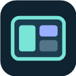

# AV GUI Studio



AV GUI Studio is a Rust desktop editor for Extron touch panel layouts. The local Windows build supports authoring and exporting one TLP Pro 1025M screen.

## Build and run

The sources the build needs beyond crates.io (craft-libs, the egui and winit forks, vectorcraft's geometry crates and the embedded fonts) are vendored in `vendor/`; see [vendor/README.md](vendor/README.md). The tools are installed into `.tools/` inside this checkout, from pinned and checksum-verified sources: the Rust toolchain named in `rust-toolchain.toml` (GNU host) and the WinLibs MinGW-w64 C compiler and libraries. Nothing outside the checkout is used or changed. Once per checkout, and again after a pin changes:

```powershell
.\scripts\bootstrap.ps1
```

Then in each new shell load the environment and build:

```powershell
. .\scripts\env.ps1
cargo build --locked --release -p figcraft -p figcraft-cli
.\target\release\av-gui-studio.exe
```

In Git Bash, `source scripts/env.sh` loads the same environment. Keep the checkout at a short path without spaces, such as `D:\DEV\AV-GUI-Studio`: the MinGW linker splits its own library paths at a space, and deep dependency files under `.tools` can pass Windows' 260-character path limit.

Choose **File → Extron → New 1025M demo** to open the editable Aurora Meeting Room example. Its **Home** frame contains labels, shapes, a slider and instances of the source and Mute button sets. Edit button state fills and captions on the variants beside the screen. Use **Validate screen**, **Export EXUI** or **Build GDL** in the same menu.

**File → Extron → New touch panel project…**, or the card on the home screen, first asks for the touch panel, as GUI Designer's New Project wizard does: TLP Pro 1025M (1280 × 800) or TLP Pro 300M portrait (320 × 480), the two panels the exporter builds GDL for, and then for a UI kit. The project opens with an empty **Home** page of that resolution.

UI kits give native controls their look and offer ready-made blocks, such as a source selection card or a volume control. Aurora, Daylight and Graphite are built in; **File → Extron → UI kits…** inserts controls and blocks, switches the project's kit and installs kit files. See [UI kits](docs/ui-kits.md) for the kit file format.

Each page of a project is an artboard of the panel's size on the canvas. The **Artboard** tool (Shift+O, beside the frame tools) adds one: click to put its top-left corner there, or drag to place it. Enter with the tool, or **File → Extron → Add page**, adds one to the right of everything on the canvas. The page with the lowest Object ID, Home, is the start page. A project of more than one page exports as an EXUI/5 project whose other pages are shown by the control program.

Controls are added with the `extron.insert` and `extron.assign` commands, from the CLI or an AI agent (see below); the editor has no toolbar for them yet. `extron.insert` takes the page of the selection, or the page in the middle of the view. Each page and control gets an Object ID, and a button or slider the same Control ID, from one counter stored on every page, so the ID of a deleted control or page is never handed out again.

Buttons and sliders are instances of **master components**: the first one inserted in a kit's look creates that kit's master beside the pages, such as **Aurora button** (a variant set with Normal, Active and Pressed) or **Aurora slider** (track, fill and thumb). Edit a master to restyle every control made from it at once; each control keeps its key, Object ID and Control ID. A button's caption is its own (an instance override) and applies to all three states; change its look on the master's variants. A problem in a master shows once in Problems, at the master. Masters stay on the canvas when their controls are deleted and are not exported. Labels and shapes are plain layers.

The **Problems** section under the layers lists every export problem of an Extron screen and updates as you edit. Select a problem to select its layer, reveal it in the layers and bring it into view. Export stays blocked until the list is empty.

EXUI export works on its own. Building GDL needs the separately distributed Extron exporter 0.8.8 (run with `dotnet`) and a donor registry whose donor GDLs are prepared. AV GUI Studio looks for them in this order:

1. the environment variables `AV_GUI_STUDIO_EXTRON_CLI` and `AV_GUI_STUDIO_EXTRON_DONORS` (the names from before the rename, `GUI_STUDIO_EXTRON_CLI` and `GUI_STUDIO_EXTRON_DONORS`, also work), set before starting the editor or CLI;
2. the exporter chosen in the app: **File → Extron → Choose GDL exporter…** asks for `Extron.Cli.dll` and then `donors.json` and keeps them in the preferences;
3. a `figma-extron-exporter` checkout beside the program or the working folder (or one of their parents), with `output\releases\0.8.8\smoke-kit\cli\Extron.Cli.dll` and the first of the smoke kit's and the checkout's `samples\donors.json` whose donors are prepared.

```powershell
$env:AV_GUI_STUDIO_EXTRON_CLI = 'D:\DEV\figma-extron-exporter\output\releases\0.8.8\smoke-kit\cli\Extron.Cli.dll'
$env:AV_GUI_STUDIO_EXTRON_DONORS = 'D:\DEV\figma-extron-exporter\samples\donors.json'
```

When none is found, **Build GDL…** asks for the exporter first. A registry without a prepared donor for the project's panel is reported with the exporter's `prepare-donor` step. In the app the build runs in the background: a banner says the GDL is being built, the window keeps working, the Extron export actions wait for it, and the result appears as a message. Use a new output filename for GDL. The app publishes the output after the converter reports all independent verification checks passed.

## Headless export

Run `av-gui-studio-cli commands --filter extron` for the registered command IDs and parameters. Save the following command array as `aurora.json`, then run `av-gui-studio-cli run aurora.json`:

```json
[
  {"command":"extron.demo"},
  {"command":"extron.validate"},
  {"command":"file.saveAs","params":{"path":"aurora.figcraft"}},
  {"command":"extron.exportExui","params":{"path":"aurora.exui"}},
  {"command":"extron.buildGdl","params":{"path":"aurora.gdl"}}
]
```

Pass `--in aurora.figcraft` to run against a saved design. `extron.validate` returns each problem with its `nodeId`, `layer` and `message`. A blocked export fails with one line per problem, such as `"Room title" (node 12): Element must fit inside the 1280 × 800 screen.` Root-confined automation can validate and export EXUI. Building GDL runs an external process and is available from the local desktop and an unconfined CLI run.

To author a screen without the editor, start from `extron.newPanel` and add controls:

```json
[
  {"command":"extron.newPanel","params":{"name":"Huddle Room"}},
  {"command":"extron.insert","params":{"kind":"label","text":"Huddle Room","x":60,"y":60}},
  {"command":"extron.insert","params":{"kind":"button","text":"Mute","x":60,"y":300}},
  {"command":"extron.insert","params":{"kind":"slider","x":300,"y":312}},
  {"command":"extron.exportExui","params":{"path":"huddle.exui"}}
]
```

`extron.assign {kind, ids?}` turns layers drawn directly in the panel into controls: a text layer into a label, a rectangle into a shape, a frame with a track, fill and thumb (or an instance of a slider master) into a slider, and an instance of a three-variant set into a button whose variants become Normal, Active and Pressed in order.

## AI agents (MCP)

`av-gui-studio-cli mcp` is an MCP server for Claude Code, Codex and other MCP clients. This repository carries [`.mcp.json`](.mcp.json) for Claude Code and [`.codex/config.toml`](.codex/config.toml) for Codex, each with a headless server and one attached to the app started with `av-gui-studio --control 7979`. Build the CLI first; setup and the tools are in [docs/mcp.md](docs/mcp.md#configure-a-client).

## License

AV GUI Studio is an independent product built on a snapshot of [FigCraft](https://github.com/storytold/figcraft) `b828e6c7`, which is licensed MIT OR Apache-2.0. Selected FigCraft changes are ported by hand ([ADR-003](.progressive/decisions/ADR-003-independent-repository.md)). See [NOTICE](NOTICE), [LICENSE-MIT](LICENSE-MIT), [LICENSE-APACHE](LICENSE-APACHE) and [asset provenance](ATTRIBUTION.md).

## Project specs

Product brief, architecture, decisions and phase plans are in [Progressive Context Kit](.progressive/project/PROJECT_BRIEF.md). The original eframe prototype is kept at tag `eframe-prototype`.
